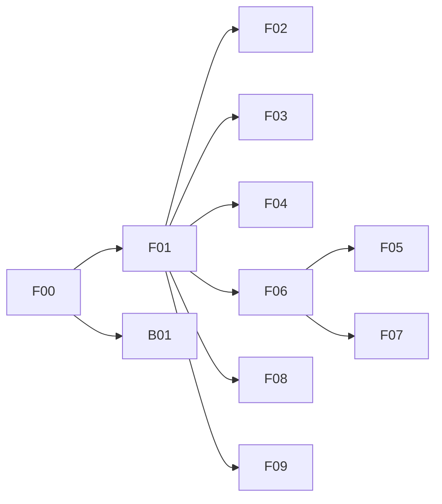

# Tamanly Flutter app — implementation plan

> **For agentic workers:** Work one module at a time. Steps use checkbox (`- [ ]`) syntax. Finish the task, run its last check, and only then change every box under that `### T` heading to `- [x]` in one edit. Then run `ruby progress.rb` from this folder. A box ticked before that check passes is a failed task.

**Goal:** Ship the Tamanly resident, owner, sub-tenant and guard app in Flutter, matching the 42 storyboard screens, against the Rails `/api/v1` already specified for this product.

**Architecture:** One Flutter app. A single `Api` client and a single `Session` own tokens, the selected unit, and locale. Feature folders own their screens. The app never hardcodes token lifetime. It trusts `expires_in` from the backend, refreshes through `POST /api/v1/auth/refresh`, and the backend rotates the pair. Access and refresh lifetimes are settings on the server, changed without a new app release.

**Tech stack:** Flutter (stable), Material 3, `go_router`, `package:http`, `flutter_secure_storage`, Firebase Messaging (push only), `mobile_scanner`, `qr_flutter`, `image_picker`, `share_plus`, `url_launcher`. EN and BM via Flutter ARB. Tests are `flutter_test`.

**Spec:** read these before any module.

- Storyboard: `../index.html` and `../screens/`. The screen code (A1, H0, …) is the UI spec.
- Product: `../../PRODUCT.md`. Roles, RM, EN/BM, Asia/Kuala_Lumpur.
- Rails API this app calls: [api.md](api.md). Where that file and the Rails plan disagree, `api.md` in this folder wins for the mobile app, and the Rails plan wins for admin behaviour.
- Rails plan (do not re-specify it): `../../docs/superpowers/plans/2026-10-04-tamanly-platform/`.
- Token TTL change for the backend agent: [modules/b01-token-rotation.md](modules/b01-token-rotation.md).
- Human-only setup: [manual.md](manual.md).

**App directory:** `tamanly/tamanly_app` (sibling of `tamanly_backend` and `plan/`). Create it in F00. Do not put the Flutter project inside `plan/storyboard/`.

## Ponytail (every module)

Intensity: **full**. Still on for the whole plan. The shortest code that matches the screen wins.

- Does it need to exist? If the screen is local-only (dark mode, quiet hours with no API field), keep it local. Do not invent an endpoint.
- Already in this app? Use `lib/api.dart`, `lib/session.dart`, `lib/widgets.dart`, `lib/theme.dart`. A second HTTP client, a second token store, or a second money formatter is a bug.
- Stdlib and the allow-list below. No `dio`, `riverpod`, `bloc`, `freezed`, `json_serializable`, `get_it`, `retrofit`, or a state-management package.
- One function before a new file. One file before a new folder. A widget used once stays in the screen file.
- DRY: a string lives in ARB. A colour lives in `theme.dart`. An error shape lives in `ApiException`. A scope check lives in `Session.allows`. A closed wire value lives in `lib/enums.dart`.
- Mark a deliberate shortcut with `// ponytail: <ceiling and when to replace it>`.
- Non-trivial logic (refresh, scope gate, idempotency key, guard verdict routing) gets one `flutter_test` that fails if it breaks. A static screen does not get a test per widget.
- Do not store card numbers. Do not format money from cents when the API sent `formatted`. Do not log tokens.

**Package allow-list:** `go_router`, `http`, `flutter_secure_storage`, `firebase_core`, `firebase_messaging`, `mobile_scanner`, `qr_flutter`, `image_picker`, `share_plus`, `url_launcher`, `uuid`, `intl`, `geolocator` (SOS only). Adding any other package requires a dated line under Decisions in this file first.

## Global constraints

- Money is MYR. Display the API `formatted` string (`RM 1,050.00`). Never use a float for a charge.
- Times from the API are ISO 8601 with `+08:00`. "Today" is `Asia/Kuala_Lumpur`.
- Languages: `en` and `ms`. Every visible string is in both ARB files.
- Roles: occupant `owner` | `tenant` | `sub_tenant`. Staff mode `guard` lands in the guard shell. Other staff use email + password and, if they also occupy a unit, the resident shell.
- Sub-tenant scopes the API accepts today: `bills_view`, `bills_pay`, `visitor_passes`, `facility_booking`. Owners and tenants hold all four. Hide an action when `Session.allows` is false. A `403 scope_missing` shows the API message.
- Permit statuses, in order: Pending Review, Docs requested, Pending Deposit, Approved, Work In Progress, Inspection Scheduled, Completed, Deposit Refunded, Rejected.
- Closed wire values are plain Dart enums in `lib/enums.dart`. No `freezed` and no `json_serializable`. JSON stays the snake_case string. An unknown value maps to a trailing `unknown` and sorts last; it does not throw. The sets are in [api.md](api.md). Server columns that are enums, and the ones that are not, are Rails ADR-014. F00, F01, and F02 T02.1 already keep these as strings. Leave that code. The next task that reads a set parses it in `lib/enums.dart`.
- Headers on every call: `Authorization`, `Accept-Language`, `X-App-Version`, `X-Device-Id`. Unit-scoped calls also send `X-Unit-Id`. Payments, bookings, passes, permits and listing creates send `Idempotency-Key`.
- Deep links use `tamanly://`.
- Touch targets are at least 48px. The guard scan path is three taps or fewer: Scan, read verdict, Admit or Deny.
- Copy is sentence case and names the next action.

## Decisions locked for this plan

Confirmed 2026-10-05. Agents follow these. Do not reopen them.

1. **Sign-in matches the API, not every control on A2.** Everyone (residents, owners, sub-tenants, guards, staff) signs in with email + password via `POST /api/v1/auth/password`. Accounts come from an admin email invite (`POST /api/v1/auth/invite/accept`). Forgot password uses `/auth/password/forgot` + `/reset`. No SMS, no phone OTP. Google and Apple buttons are not built. (Changed 2026-10-14.)
2. **Sub-tenant chips match the API allow-list** (`bills_view`, `bills_pay`, `visitor_passes`, `facility_booking`). The Permits and Marketplace chips on A6 are not sent.
3. **The Flutter project is created at `tamanly/tamanly_app`.** Plans stay in this folder.
4. **No saved-card vault.** G1 "Payment methods" opens the Billplz return path and the bank-transfer instructions. The app does not store a PAN.
5. **Home search filters the feed already loaded.** No search endpoint.
6. **Guard "real-time" is a 15s poll** of `GET /api/v1/guard/home` while the Gate screen is visible.
7. **Boom-gate Override** dials the station phone from `guard/home`. No boom-gate endpoint.
8. **Dark mode** is `ThemeMode.system` vs light. Dark is `ColorScheme.fromSeed` of indigo. There is no second designed palette.
9. **Quiet hours** stay on the device until `notification_preferences` grows a `quiet_hours` field. Push delivery rules stay on the server.

## Review focus

1. A refresh that fails, or a reused refresh token the server rejects, signs the user out and clears both tokens. It does not loop.
2. Two requests that get `401 token_expired` at the same time share one refresh call.
3. A sub-tenant without `bills_pay` never sees a working Pay button (E5, H0 bill card, inbox Pay now).
4. The selected unit is sent as `X-Unit-Id`. Switching unit on A5 reloads Home, bills, visitors and permits for that unit.
5. A payment, booking, pass, permit or listing create retries with the same `Idempotency-Key` after a dropped response.

## Module map

| ID | Module | Depends on | Screens |
|---|---|---|---|
| F00 | [Shell](modules/f00-shell.md) | none | theme, tabs, session |
| B01 | [Token rotation (backend)](modules/b01-token-rotation.md) | Rails M01 when that lands | none (API) |
| F01 | [Access & accounts](modules/f01-access.md) | F00 | A1 A2 A3 A4 A5 A6 A7 |
| F02 | [Home & community](modules/f02-home.md) | F00 F01 | H0 B1 B2 B3 B4 |
| F03 | [Visitors & SOS](modules/f03-visitors.md) | F00 F01 | C1 C2 C3 C4 |
| F04 | [Guard mode](modules/f04-guard.md) | F00 F01 | C5 C6 C7 C8 C9 |
| F05 | [Permits](modules/f05-permits.md) | F00 F01 F06 pay | D1 D2 D3 D4 D5 D6 D7 |
| F06 | [Billing](modules/f06-billing.md) | F00 F01 | E1 E2 E3 E4 E5 |
| F07 | [Facilities](modules/f07-facilities.md) | F00 F01 F06 pay | F1 F2 F3 |
| F08 | [Notifications](modules/f08-notifications.md) | F00 F01 | B5 B6 |
| F09 | [Profile](modules/f09-profile.md) | F00 F01 | G1 G2 G3 G4 |

F02, F03, F06 and F08 can run in parallel after F01. F04 can run in parallel with those. F05 and F07 wait on the pay screen in F06 (the `PaymentSheet` widget).

## Shells

Resident bottom bar, from H0: **Home · Services · QR Pass · Bills · Me**. QR Pass is the raised center button and opens Visitors (C1).

Guard bottom bar, from C5: **Gate · Log · Scan · Permits · Me**. Scan is the raised center button and opens the camera (C6). A user with `modes` containing `guard` and no occupancy lands here after sign-in. A user with both gets a switch on Me. Default after sign-in is guard mode when `guard` is present and the last choice was guard.

## Progress

Run `ruby progress.rb` in this folder after you tick a task. It rewrites the table.

<!-- progress:start -->
| | Module | Status | Owner | Tasks | Steps |
|---|---|---|---|---|---|
| `░░░░░░░░░░░░░░░░░░░░` 0% | [B01 · Configurable token rotation](modules/b01-token-rotation.md) | Not started | — | 0/2 | 0/9 |
| `████████████████████` 100% | [F00 · Shell](modules/f00-shell.md) | Done | grok | 3/3 | 14/14 |
| `████████████████████` 100% | [F01 · Access & accounts](modules/f01-access.md) | Done | grok | 3/3 | 13/13 |
| `██████░░░░░░░░░░░░░░` 33% | [F02 · Home & community](modules/f02-home.md) | In progress | grok | 1/3 | 4/12 |
| `░░░░░░░░░░░░░░░░░░░░` 0% | [F03 · Visitors & SOS](modules/f03-visitors.md) | Not started | — | 0/2 | 0/8 |
| `░░░░░░░░░░░░░░░░░░░░` 0% | [F04 · Guard mode](modules/f04-guard.md) | Not started | — | 0/2 | 0/8 |
| `░░░░░░░░░░░░░░░░░░░░` 0% | [F05 · Permits](modules/f05-permits.md) | Not started | — | 0/2 | 0/8 |
| `░░░░░░░░░░░░░░░░░░░░` 0% | [F06 · Billing & payments](modules/f06-billing.md) | Not started | — | 0/2 | 0/8 |
| `░░░░░░░░░░░░░░░░░░░░` 0% | [F07 · Facilities](modules/f07-facilities.md) | Not started | — | 0/2 | 0/8 |
| `░░░░░░░░░░░░░░░░░░░░` 0% | [F08 · Notifications](modules/f08-notifications.md) | Not started | — | 0/2 | 0/9 |
| `░░░░░░░░░░░░░░░░░░░░` 0% | [F09 · Profile & settings](modules/f09-profile.md) | Not started | — | 0/2 | 0/8 |
| `█████░░░░░░░░░░░░░░░` **29%** | **Total** | | | **7/25** | **31/105** |
<!-- progress:end -->

## Manual progress

<!-- manual:start -->
`░░░░░░░░░░░░░░░░░░░░` 0% · 0/28 manual items ticked in [manual.md](manual.md). The human ticks these. The agent does not.
<!-- manual:end -->

## Agent protocol

1. **Claim.** In the module header set `**Status:** In progress` and `**Owner:** <name>`. One module per agent at a time. Do not edit another agent's module.
2. **Read.** This README (Ponytail, Global constraints, Decisions, Review focus), [api.md](api.md), and the module file. Open the storyboard images named in the task.
3. **Branch.** `app/<module>-<task>` from the app repo, for example `app/f01-sign-in`.
4. **Build the smallest slice.** Follow the task steps. Reuse F00 types. Do not rename them.
5. **Check, then tick the whole task.** Run the commands the steps name. The last check in the task is the gate. On pass, set every `- [ ]` under that `### T` heading to `- [x]` in one edit. On fail, leave every box in that task empty and fix the code. Then run `ruby progress.rb` from this folder.
6. **A task is done** when every box under its `### T` heading is ticked. `progress.rb` counts the task only then. `flutter test` for the module stays green.
7. **Finish the module.** Definition of done below, then set Status to `Done`.

Status values: `Not started`, `In progress`, `Blocked`, `Done`.

## Definition of done (every module)

- [ ] Every task box in the module is ticked, and each tick followed a passing check.
- [ ] `flutter test` and `flutter analyze` are clean.
- [ ] New strings exist in `lib/l10n/app_en.arb` and `lib/l10n/app_ms.arb`.
- [ ] No package was added outside the allow-list.
- [ ] `ruby progress.rb` has been run and this README shows the new counts.

## How the backend token expiry is configured

The mobile app does not contain the lifetime. [B01](modules/b01-token-rotation.md) stores three settings:

| Key | Default | Meaning |
|---|---|---|
| `auth.access_ttl_seconds` | `3600` | Access token lifetime. The JSON field `expires_in` is this value. |
| `auth.refresh_ttl_seconds` | `5184000` | Refresh token lifetime (60 days). |
| `auth.refresh_reuse_grace_seconds` | `10` | A second refresh with the old token inside this window does not kill the family. |

Changing a number in admin applies to the next sign-in and the next refresh. Tokens already issued keep the expiry they were given. The app refreshes `expires_in - 60` seconds after issue, and also on `401` with code `token_expired`.
